<p align="center">
  
</p>

[English](README.md) · [Deutsch](README_de.md) · [Español](README_es.md) · [简体中文](README_zh-Hans.md) · [日本語](README_ja.md) · [Русский](README_ru.md)

# clutch

> Motor de orquestación LLM neutral al proveedor con aprendizaje automático


**clutch** (alemán: *Kupplung*, «embrague») utiliza una metáfora automovilística para enrutar tareas de forma inteligente hacia los modelos LLM óptimos entre múltiples proveedores. Analiza la complejidad y el propósito de cada tarea, selecciona el modelo y el nivel de razonamiento adecuados, realiza un seguimiento del presupuesto y aprende de la experiencia. Úsalo como **biblioteca**, **CLI** o **aplicación web local**.

## Funcionalidades

- **Neutral al proveedor** -- Anthropic (Claude), Google (Gemini), Ollama (local y remoto), Claude Code y **Kimi** (Moonshot API / CLI / Ollama Cloud)
- **Enrutamiento automático** -- analiza la complejidad *y el propósito* de la tarea (codificación, visión, investigación, bulk) y elige el modelo óptimo + nivel de razonamiento
- **Consciente del propósito y la visión** -- dirige entradas de imágenes/documentos a modelos con capacidad de visión; adapta las tareas a las fortalezas de cada modelo
- **CLI + interfaz web** -- `clutch route/run/chat/models/stats`, más un chat web FastAPI opcional (`clutch serve --web`)
- **Almacén de credenciales** -- guarda las claves API en `~/.clutch/credentials.json` (`clutch keys ...`); las variables de entorno tienen prioridad
- **Descubrimiento de modelos** -- detección automática de modelos Ollama instalados (local/remoto) y endpoints `/v1/models` compatibles con OpenAI
- **Seguimiento de presupuesto** -- indicador de combustible de cuatro zonas (verde/amarillo/naranja/rojo) con límites diarios y mensuales
- **Motor de aprendizaje** -- puntuación de aptitud y exploración epsilon-greedy que mejora el enrutamiento con el tiempo
- **Patrones de ejecución** -- tareas individuales, cadenas (Kolonne/convoy), equipos paralelos y procesamiento en enjambre
- **Monitoreo de salud** -- cortacircuitos, seguimiento de latencia, alertas de overkill/explosión de tokens, failover de proveedores
- **Métricas SQLite** -- registro de viajes persistente, sesiones de chat, biblioteca de prompts y perfiles

## Arquitectura

El sistema completo sigue una **metáfora automovilística** (términos en alemán, identificadores de código):

```
                    +----------------------------------+
                    |            FAHRER                 |
                    |        (Driver / Orchestrator)    |
                    |     Any LLM: Opus, Gemini, ...   |
                    +--------+----------+--------------+
                             |          |
                +------------+          +-------------+
                |                                     |
        +-------v--------+                   +--------v-------+
        |    STRECKE      |                   |    GETRIEBE    |
        | (Road / Task    |                   | (Gearbox /     |
        |  Analysis)      |                   |  Model Registry|
        +----------------+                   |                |
                                              | G1: Haiku      |
        +----------------+                   | G2: Flash      |
        |   GAS / BREMSE  |                   | G3: Sonnet     |
        | (Throttle/Brake |                   | G4: Gemini Pro |
        |  Reasoning Lvl) |                   | G5: Opus       |
        +----------------+                   | + Ollama local |
                                              +----------------+
        +----------------+
        |    KUPPLUNG     |    +------------+    +-------------+
        | (Clutch / Model |    |   TACHO    |    |  TANKUHR    |
        |  Switching)     |    | (Metrics)  |    | (Budget)    |
        +----------------+    +------------+    +-------------+
```

| Componente | Rol | Módulo |
|-----------|------|--------|
| **Fahrer** (Conductor) | Orquestador -- elige modelo, razonamiento y patrón de ejecución | `fahrer.py` |
| **Strecke** (Ruta) | Análisis y clasificación de tareas | `strecke.py` |
| **Getriebe** (Caja de cambios) | Registro de modelos neutral al proveedor | `getriebe.py` |
| **Gang** (Marcha) | Un modelo específico (G1--G5) | `getriebe.py` |
| **Gas/Bremse** (Acelerador/Freno) | Nivel de razonamiento (0--100 %) | `gas_bremse.py` |
| **Kupplung** (Embrague) | Mecanismo de cambio de modelo | `kupplung.py` |
| **MotorBlock** (Bloque motor) | Capa unificada de llamadas a la API | `motorblock.py` |
| **Tacho** (Velocímetro) | Recopilación de métricas | `tacho.py` |
| **Tankuhr** (Indicador de combustible) | Seguimiento de presupuesto (4 zonas) | `tankuhr.py` |
| **Bordcomputer** (Ordenador de a bordo) | Monitor de salud, cortacircuitos | `bordcomputer.py` |
| **Fahrtenbuch** (Libro de viajes) | Almacenamiento SQLite de métricas | `fahrtenbuch.py` |
| **Fahrschule** (Autoescuela) | Motor de aprendizaje / evolución | `fahrschule.py` |

## Tipos de ruta

| Ruta | Dificultad | Marcha por defecto | Acelerador | Patrón |
|------|-----------|-------------|----------|---------|
| Feldweg (Camino de tierra) | Trivial | Haiku (G1) | 30 % | Individual |
| Landstrasse (Carretera comarcal) | Estándar | Sonnet (G3) | 50 % | Individual |
| Bundesstrasse (Carretera nacional) | Corrección de bugs | Sonnet (G3) | 70 % | Individual |
| Autobahn (Autopista) | Arquitectura | Opus (G5) | 90 % | Individual |
| Rallye (Rally) | Operaciones bulk | Haiku (G1) | 30 % | Enjambre |
| Konvoi (Convoy) | Pipeline | Sonnet (G3) | 50 % | Cadena |
| Teamfahrt (Viaje en equipo) | Multi-archivo | Sonnet (G3) | 50 % | Equipo |
| Langstrecke (Larga distancia) | Complejo | Opus (G5) | 90 % | Híbrido |

## Instalación

```bash
git clone https://github.com/ellmos-ai/clutch.git
cd clutch
pip install -e .
```

### Requisitos

- Python 3.10+
- Claves API para los proveedores deseados (como variables de entorno):
  - `ANTHROPIC_API_KEY` para modelos Claude
  - `GOOGLE_API_KEY` para modelos Gemini
  - Ollama ejecutándose localmente para modelos locales

## Inicio rápido

```python
from clutch import Fahrer

# Crear un conductor (usa todos los proveedores configurados)
fahrer = Fahrer()

# Describir la tarea -- el conductor se encarga de todo
result = fahrer.fahren(
    "Fix the authentication bug in the login module",
    handler=my_handler,
)

# Inspeccionar lo que fue elegido
print(result.config.gang.name)       # "claude-sonnet"
print(result.config.gang.provider)   # "anthropic"
print(result.config.gas.wert)        # 0.7

# Panel de control
status = fahrer.status()
print(status["tankuhr"]["zone"])     # "green"
print(status["getriebe"])            # "Getriebe[haiku(G1), flash(G2), ...]"

# Aprender de ejecuciones pasadas
fahrer.trainieren()
```

## Interfaz de línea de comandos

Tras `pip install -e .` el comando `clutch` está disponible:

```bash
clutch route "Fix the auth bug"      # mostrar la decisión de enrutamiento (dry-run, sin llamada LLM)
clutch "Explain quantum computing"    # ejecución única: enrutar + ejecutar, imprimir la respuesta
clutch run "..." --json               # salida legible por máquina (para otros agentes)
clutch chat                           # REPL interactivo
clutch models [--json]                # listar todas las marchas (modelos)
clutch stats                          # panel de uso / presupuesto / salud
clutch config <key> [value]           # leer/establecer configuración CLI
clutch keys set MOONSHOT_API_KEY      # almacenar una clave API (entrada oculta; valores nunca mostrados)
clutch keys list                      # listar nombres de claves almacenadas (sin valores)
clutch serve --web                    # iniciar la interfaz web (requiere: pip install -e ".[web]")
```

Tres modos de uso: **consola** (personas), **interfaz web** (personas, gráfica) y **CLI/API**
(otros LLMs/agentes enrutan tareas via `--json` o el endpoint web compatible con OpenAI).

## Claves API y credenciales

clutch resuelve las claves en este orden (el primero no vacío gana):

1. Variable de entorno (p. ej. `MOONSHOT_API_KEY`) -- preferido para CI/servidores
2. Almacén clutch `~/.clutch/credentials.json` (via `clutch keys set`; texto sin cifrar, modo POSIX 0600 best effort)
3. Archivos `~/.credentials/<name>` (interoperabilidad con herramientas hermanas)

Los valores nunca se imprimen, registran ni confirman en repositorios.

## Configuración

La configuración por defecto reside en `clutch/config/`, de modo que las instalaciones editables y los wheels usan los mismos valores por defecto de enrutamiento. Pasa un `base_dir` personalizado con su propia carpeta `config/` a `Fahrer` si deseas sobreescrituras específicas del proyecto.

| Archivo | Propósito |
|------|---------|
| `kupplung.json` | Configuración global (valores por defecto del conductor, límites de enjambre, presupuesto) |
| `getriebe.json` | Todas las marchas + asignaciones de proveedores |
| `strecken.json` | Asignación tipo de ruta a marcha/acelerador |
| `fitness_criteria.json` | Umbrales del motor de aprendizaje |

### Zonas de presupuesto

| Zona | Uso | Marchas permitidas |
|------|-------|--------------|
| Verde | 0--30 % | Todas (G1--G5) |
| Amarillo | 30--60 % | G1--G3 |
| Naranja | 60--80 % | Solo G1--G2 |
| Rojo | 80--100 % | Ninguna (presupuesto agotado) |

## Proveedores compatibles

| Proveedor | Modelos | Local |
|----------|--------|-------|
| **Anthropic** | Claude Haiku, Sonnet, Opus | No |
| **Google** | Gemini Flash, Pro | No |
| **Ollama** | Qwen, Mistral y más (local y remoto) | Sí |
| **Claude Code** | Via subprocess (sesión CLI) | Sí |
| **Kimi (Moonshot)** | `kimi-k2.7-code`, `kimi-k2.6` via API compatible con OpenAI; `kimi-cli`/`kimi-code` CLI; Ollama Cloud | API / CLI |
| **Compatible con OpenAI** | Cualquier endpoint `/v1/chat/completions` (configurar `base_url`) | No |

## Patrones de ejecución

- **Individual** -- un modelo, una tarea
- **Convoy (Kolonne)** -- cadena secuencial, la salida N alimenta la entrada N+1
- **Equipo** -- trabajadores especializados en paralelo, resultados fusionados
- **Enjambre** -- microtareas masivamente paralelas (p. ej., 20x Haiku), luego agregación

## Estructura del proyecto

```
clutch/
+-- clutch/
|   +-- __init__.py
|   +-- fahrer.py          # Orquestador
|   +-- strecke.py         # Análisis de tareas
|   +-- getriebe.py        # Registro de modelos
|   +-- kupplung.py        # Cambio de modelos
|   +-- motorblock.py      # Capa API unificada
|   +-- gas_bremse.py      # Nivel de razonamiento
|   +-- fahrtenbuch.py     # Métricas SQLite
|   +-- bordcomputer.py    # Monitor de salud
|   +-- tankuhr.py         # Seguimiento de presupuesto
|   +-- tacho.py           # Métricas
|   +-- fahrschule.py      # Motor de aprendizaje
|   +-- patterns/
|       +-- kolonne.py     # Patrón de cadena
|       +-- team.py        # Patrón paralelo
|       +-- schwarm.py     # Patrón de enjambre
|       +-- hybrid.py      # Patrón híbrido
|   +-- config/
|       +-- kupplung.json
|       +-- getriebe.json
|       +-- strecken.json
|       +-- fitness_criteria.json
+-- tests/
|   +-- test_clutch.py
|   +-- test_learning.py
|   +-- test_patterns.py
|   +-- test_route.py
+-- data/                  # Datos en tiempo de ejecución (no rastreados)
```

## Pruebas

```bash
python -m pip install -e ".[test]" build
pytest -q
```

Pytest está configurado para recopilar solo `tests/`. Los scripts de prueba en el directorio raíz como
`demo.py`, `live_test.py` y `claude_code_test.py` son comprobaciones manuales de proveedores.

## Contribuir

Consulta [CONTRIBUTING.md](CONTRIBUTING.md) para las directrices.
Para los términos de la API automovilística alemana, consulta [GLOSSARY.md](GLOSSARY.md).

## Datos, proveedores y límites de ejecución

Por defecto, clutch guarda la configuración y el historial local bajo ~/.clutch; algunos comandos permiten indicar otras rutas. Al elegir un proveedor remoto, el prompt y el contexto enviado pueden llegar a ese servicio y se aplican sus propias condiciones y ajustes de cuenta. Las claves API guardadas en ~/.clutch/credentials.json son texto sin cifrar; el modo POSIX 0600 se intenta aplicar, pero no ofrece cifrado ni una garantía de ACL en todas las plataformas. Las zonas de presupuesto son umbrales locales, no límites de facturación del proveedor. Los procesos CLI heredan los permisos y el entorno de quien los inicia. La interfaz FastAPI opcional está pensada para uso local; clutch no bloquea de forma general el tráfico saliente ni certifica el alojamiento público. La aplicación HTTP actual sirve la página raíz, pero no define rutas para los recursos estáticos locales que esta referencia; por eso, el funcionamiento completo de la interfaz en el navegador aún no está verificado.

## Licencia

Licencia MIT. Consulta [LICENSE](LICENSE) para más detalles.

---

## Responsabilidad / Haftung

clutch se distribuye bajo la licencia MIT indicada en [LICENSE](LICENSE). Esta documentación ofrece información general y no constituye asesoramiento jurídico. Las obligaciones legales y la responsabilidad dependen de los hechos y de la legislación aplicable; esta página no formula una determinación general de cumplimiento o responsabilidad.
