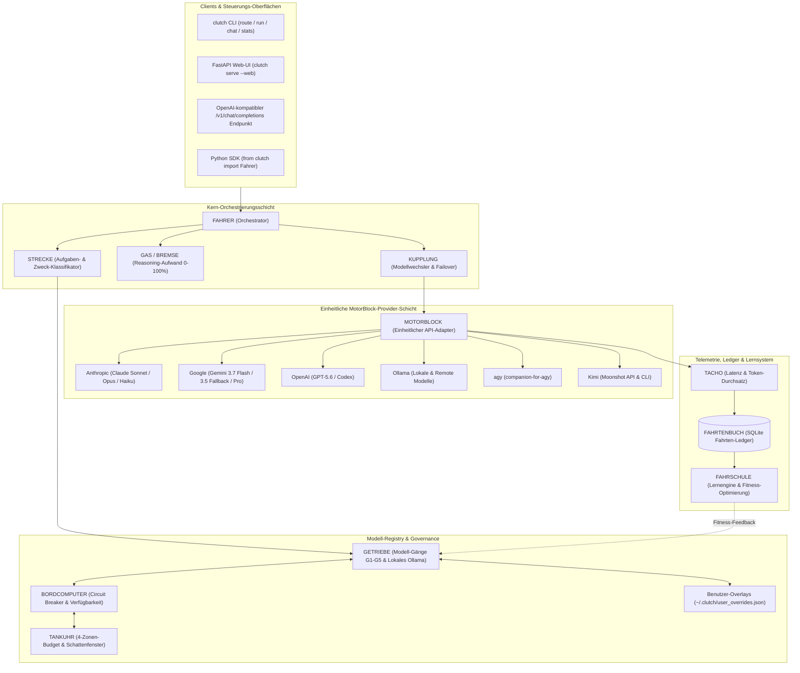
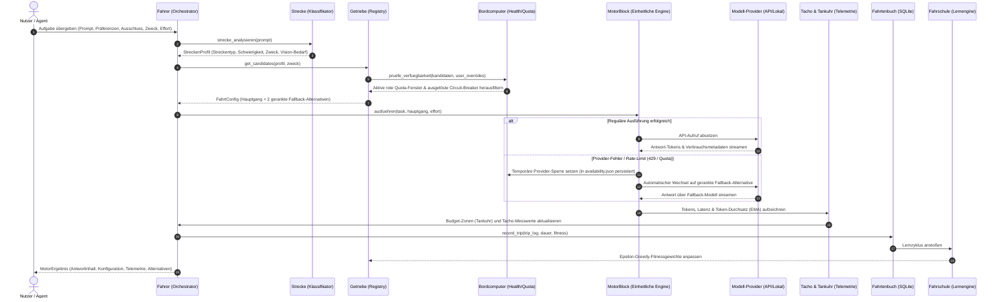

> Archivierte ausführliche Vorgängerfassung der aktuellen [README_de.md](../../README_de.md). Ausgangsstand: Commit `67c5b72fd2ea6d1e91e47f363d8ab9f951b9fd44`. Dieses datierte Archiv erhält den früheren Leitfaden mit korrigierten aktuellen Aussagen; der aktive Einstieg ist die kurze README im Repository-Stamm.

<p align="center">
  
</p>

[English](../../README.md) · [Deutsch](../../README_de.md) · [Español](../../README_es.md) · [简体中文](../../README_zh-Hans.md) · [日本語](../../README_ja.md) · [Русский](../../README_ru.md)

# clutch


[](https://github.com/ellmos-ai/clutch/actions/workflows/ci.yml)

[](../../LICENSE)
**clutch** (deutsch: *Kupplung*) verwendet eine intuitive automobile Fahrmetapher, um Aufgaben intelligent an optimale LLM-Modelle verschiedener Anbieter weiterzuleiten. Das System analysiert Aufgabenkomplexität und -zweck, wählt die passende Gangstufe und das ideale Reasoning-Level, verfolgt Budgets mit einer Vier-Zonen-Tankuhr, setzt persistente Circuit-Breaker durch und lernt aus Erfahrungen. Verwendbar als **Bibliothek**, **CLI** oder **lokale Web-App**.

> [!NOTE]
> Für KI-Agenten, Crawler und automatisierte Indexierer stehen maschinenlesbare Metadaten und Entdeckungskontexte in [llms.txt](../../llms.txt) bereit.

---

## Schnellnavigation

1. [Funktionen & Highlights](#1-features)
2. [Architektur & Metaphern-Abbildung](#2-architecture)
3. [Typische Einsatzbereiche](#3-target-personas--discoverability)
4. [Nutzungsarten & Grenzen](#4-comparative-matrix-vs-alternatives)
5. [Duale Mermaid-Diagramme](#5-dual-mermaid-diagrams)
6. [Laufzeitumfang & Datengrenzen](#6-governance--runtime-invariants)
7. [Streckentypen & Aufgabenklassifikation](#7-road-types)
8. [Installation & Voraussetzungen](#8-installation)
9. [Schnellstart & Kurzanleitung](#9-quick-start)
10. [Kommandozeilen-Schnittstelle (CLI)](#10-command-line-interface)
11. [API-Keys & Zugangsdaten](#11-api-keys--credentials)
12. [Konfiguration & Benutzer-Overlays](#12-configuration)
13. [Unterstützte Provider & Modell-Gänge](#13-supported-providers)
14. [Ausführungsmuster](#14-execution-patterns)
15. [Verwandte Tools & Ökosystem](#15-ecosystem--sibling-tools)
16. [Deklarierte Abhängigkeiten & Lizenzumfang](#16-third-party-licenses--transparency)
17. [Sicherheitshinweise & rechtlicher Rahmen](#17-security-policy--liability)
18. [Prüfungen & Testbefehle](#18-verification--test-suite)

---

<a id="1-features"></a>
<a id="features"></a>
<a id="funktionen"></a>
## 1. Funktionen & Highlights

- **Provider-neutral** -- Anthropic (Claude), Google (Gemini), OpenAI (GPT/Codex), Ollama (lokal & remote), Claude Code, **agy via companion-for-agy** sowie **Kimi** (Moonshot API / CLI / Ollama Cloud)
- **Automatisches Routing** -- analysiert Aufgabenkomplexität *und Zweck* (Coding, Vision, Recherche, Bulk) und wählt optimales Modell + Reasoning-Level
- **Zweck- und Vision-bewusst** -- leitet Bild-/Dokumenteingaben an vision-fähige Modelle weiter; passt Aufgaben an Modellstärken an
- **CLI + Web-UI** -- `clutch route/run/chat/models/stats`, plus optionale FastAPI-Web-Chat-Oberfläche (`clutch serve --web`)
- **Credential-Speicher** -- API-Keys in `~/.clutch/credentials.json` ablegen (`clutch keys ...`); Umgebungsvariablen haben Vorrang
- **Modell-Erkennung** -- automatische Erkennung installierter Ollama-Modelle (lokal/remote) und OpenAI-kompatibler `/v1/models`-Endpunkte
- **Budget-Tracking** -- Tankuhr mit vier Zonen (grün/gelb/orange/rot) mit täglichen und monatlichen Limits
- **Lernengine** -- Fitness-Scoring und Epsilon-Greedy-Exploration, die das Routing im Laufe der Zeit verbessert
- **Ausführungsmuster** -- Einzelaufgaben, Ketten (Kolonne), parallele Teams und Schwarm-Verarbeitung
- **Persistente Verfügbarkeit** -- Circuit-Breaker und Kontingentsperren überleben One-Shot-Prozesse; rote Anthropic-5h/7d-Fenster, `notaus` und Provider-Rate-Limits werden bis zum Reset umgangen
- **Update-festes Nutzer-Overlay** -- Modelle deaktivieren, Modelle/Provider bevorzugen, Gangstufen begrenzen, Aliase und Modellkosten in `~/.clutch/user_overrides.json` pflegen
- **Beleggestützte Ausführungsselektoren** -- Runner-, Familien- und exakte Modellbindungen ohne stille Ersetzung auflösen; Provider-Adapter halten fünf Verfügbarkeitsstufen getrennt
- **Routing-Wünsche pro Aufruf** -- Gänge bevorzugen oder ausschließen, Zweck/Effort überschreiben und zwei gerankte Fallback-Alternativen erhalten
- **Gesundheitsüberwachung** -- persistente Circuit-Breaker, Latenz-Tracking, Overkill/Token-Explosion-Alarme, Provider-Failover
- **SQLite-Metriken** -- persistentes Fahrtenbuch, Chat-Sitzungen, Prompt-Bibliothek und Profile

---

<a id="2-architecture"></a>
<a id="architecture"></a>
<a id="architektur"></a>
## 2. Architektur & Metaphern-Abbildung

Das gesamte System folgt einer **Auto-/Fahrmetapher**:

```
                    +----------------------------------+
                    |            FAHRER                 |
                    |        (Driver / Orchestrator)    |
                    |     Any LLM: Opus, Gemini, ...   |
                    +--------+----------+--------------+
                             |          |
                +------------+          +-------------+
                |                                     |
        +-------v--------+                   +--------v-------+
        |    STRECKE      |                   |    GETRIEBE    |
        | (Road / Task    |                   | (Gearbox /     |
        |  Analysis)      |                   |  Model Registry|
        +----------------+                   |                |
                                              | G1: Haiku      |
        +----------------+                   | G2: Flash      |
        |   GAS / BREMSE  |                   | G3: Sonnet     |
        | (Throttle/Brake |                   | G4: Gemini Pro |
        |  Reasoning Lvl) |                   | G5: Opus       |
        +----------------+                   | + Ollama local |
                                              +----------------+
        +----------------+
        |    KUPPLUNG     |    +------------+    +-------------+
        | (Clutch / Model |    |   TACHO    |    |  TANKUHR    |
        |  Switching)     |    | (Metrics)  |    | (Budget)    |
        +----------------+    +------------+    +-------------+
```

| Komponente | Rolle | Modul |
|-----------|------|--------|
| **Fahrer** (Driver) | Orchestrator -- wählt Modell, Reasoning und Ausführungsmuster | `fahrer.py` |
| **Strecke** (Road) | Aufgabenanalyse und -klassifikation | `strecke.py` |
| **Getriebe** (Gearbox) | Provider-neutrale Modell-Registry | `getriebe.py` |
| **Gang** (Gear) | Ein konkretes Modell (G1--G5) | `getriebe.py` |
| **Gas / Bremse** (Throttle/Brake) | Reasoning-Level (0--100%) | `gas_bremse.py` |
| **Kupplung** (Clutch) | Schaltmechanismus zwischen Modellen | `kupplung.py` |
| **MotorBlock** (Engine) | Einheitliche API-Aufrufschicht | `motorblock.py` |
| **Tacho** (Speedometer) | Metriken-Erfassung | `tacho.py` |
| **Tankuhr** (Fuel Gauge) | Budget-Tracking (4 Zonen) | `tankuhr.py` |
| **Bordcomputer** (Onboard Computer) | Health-Monitor, Circuit-Breaker | `bordcomputer.py` |
| **Fahrtenbuch** (Trip Log) | SQLite-Metrikspeicher | `fahrtenbuch.py` |
| **Fahrschule** (Driving School) | Lernengine / Auto-Tuning | `fahrschule.py` |
| **Token-Throughput** (Schattenzone) | Anthropic 5h/7d-Rate-Limit-Fenster als zweite Zone -- siehe [`docs/STAGED-MIGRATION.md`](../../docs/STAGED-MIGRATION.md) | `token_throughput.py` |

---

<a id="3-target-personas--discoverability"></a>
<a id="target-personas--discoverability"></a>
<a id="zielgruppen--auffindbarkeit"></a>
## 3. Typische Einsatzbereiche

clutch ist als Python-Bibliothek, Kommandozeilenprogramm und optionale FastAPI-Weboberfläche verfügbar. Die Web-Abhängigkeiten werden mit dem [web-Extra](#8-installation) installiert.

- Anwendungsrouting: Für eine Aufgabe einen Provider- und Modellpfad wählen und die aufgelöste Auswahl vor der Ausführung prüfen.
- Lokale oder gehostete Provider: Die konfigurierten SDKs mit unterstützten Diensten oder einen konfigurierten Ollama-Endpunkt verwenden. Provider-Anfragen richten sich nach der jeweiligen API und den Kontoeinstellungen.
- Automatisierung: Bibliothek oder CLI in einem selbst verwalteten Ablauf aufrufen. Manche Ausführungspfade starten ein externes Kommandozeilenprogramm.
- Budgetübersicht: Lokale Schwellenwerte und Verbrauchsschätzungen konfigurieren. Diese Werte begrenzen keine Provider-Rechnung.

Siehe [Laufzeitumfang & Datengrenzen](#6-governance--runtime-invariants), [SECURITY.md](../../SECURITY.md) und [CONTRIBUTING.md](../../CONTRIBUTING.md).

---


<a id="4-comparative-matrix-vs-alternatives"></a>
<a id="comparative-matrix-vs-alternatives"></a>
<a id="vergleichsmatrix-gegenueber-alternativen"></a>
## 4. Nutzungsarten & Grenzen

| Modus | Einstieg | Funktion |
|---|---|---|
| Python-Bibliothek | from clutch import Fahrer | Routing aus einer Python-Anwendung konfigurieren und aufrufen. |
| CLI | clutch run, clutch resolve | Aufgabe übergeben oder Routing-Auflösung anzeigen. |
| Optionale Weboberfläche | pip install clutch-router[web] | Die Oberfläche mit den optionalen FastAPI-Abhängigkeiten starten. |

Routing und Budgetfunktionen isolieren weder Provider-Anfragen noch externe CLI-Prozesse oder die Hostumgebung. Prüfe konfigurierte Endpunkte und Providerbedingungen, bevor du vertrauliche Inhalte sendest. Die optionale Weboberfläche ist kein gehärteter öffentlicher Hostingdienst.

---


<a id="5-dual-mermaid-diagrams"></a>
<a id="dual-mermaid-diagrams"></a>
<a id="duale-mermaid-diagramme"></a>
## 5. Duale Mermaid-Diagramme

### 1. Systemarchitektur-Topologie



### 2. End-to-End Task- & Routing-Lebenszyklus



---

<a id="6-governance--runtime-invariants"></a>
<a id="governance--runtime-invariants"></a>
<a id="governance--laufzeit-invarianten"></a>
## 6. Laufzeitumfang & Datengrenzen

| Bereich | Aktuelles Verhalten | Grenze |
|---|---|---|
| Provider-Aufrufe | Das konfigurierte SDK oder der Adapter sendet Anfragen an den ausgewählten Provider; Ollama kann lokal oder entfernt erreichbar sein. | Bei einem entfernten Provider können Prompts und übergebener Kontext den Rechner verlassen. |
| Lokaler Zustand | Konfiguration, Zugangsdaten, Verlauf und weitere Zustandsdaten liegen standardmäßig unter ~/.clutch; einzelne Befehle können eigene Pfade unterstützen. | Lokale Standardpfade verhindern keine abweichende Wahl durch Nutzer oder Integrationen. |
| Zugangsdaten | Gespeicherte API-Schlüssel sind unverschlüsselte Textwerte; die POSIX-Dateiberechtigung 0600 wird bestmöglich gesetzt. | Das ist keine Verschlüsselung und keine plattformübergreifende ACL-Garantie. Schütze Benutzerprofil und Zugangsdaten separat. |
| Budget-Zonen | Vier Zonen fassen konfigurierte lokale Schwellenwerte und Verbrauchsschätzungen zusammen. | Sie sind keine Abrechnungsgrenzen des Providers und können von dessen Rechnung abweichen. |
| CLI-Integrationen | Manche Ausführungspfade starten Provider- oder Coding-Agent-Programme. | Kindprozesse übernehmen Berechtigungen und Umgebung des aufrufenden Kontos. |
| Weboberfläche | FastAPI/Uvicorn sind optionale Abhängigkeiten des web-Extras. | Die Oberfläche ist für lokale Nutzung vorgesehen; das Projekt bietet keine allgemeine Egress-Sperre und keine Zertifizierung für öffentliches Hosting. |
| Plattformprüfungen | CI prüft unterstützte Python-Versionen unter Linux, Windows und macOS. | CI-Ergebnisse sind Testbelege, kein Sicherheits-Audit und keine Garantie identischen Verhaltens auf jedem Host. |

Details zu Datenverarbeitung und Sicherheitsmeldungen stehen in [SECURITY.md](../../SECURITY.md).

---


<a id="7-road-types"></a>
<a id="road-types"></a>
<a id="streckentypen"></a>
## 7. Streckentypen & Aufgabenklassifikation

| Strecke | Schwierigkeit | Standard-Gang | Gas/Throttle | Muster |
|---------|--------------|---------------|--------------|--------|
| **Feldweg** | Trivial | Haiku (G1) | 30% | Single |
| **Landstrasse** | Standard | Sonnet (G3) | 50% | Single |
| **Bundesstrasse** | Bugfix | Sonnet (G3) | 70% | Single |
| **Autobahn** | Architektur | Opus (G5) | 90% | Single |
| **Rallye** | Bulk ops | Haiku (G1) | 30% | Swarm |
| **Konvoi** | Pipeline | Sonnet (G3) | 50% | Chain |
| **Teamfahrt** | Multi-File | Sonnet (G3) | 50% | Team |
| **Langstrecke** | Komplex | Opus (G5) | 90% | Hybrid |

---

<a id="8-installation"></a>
<a id="installation"></a>
## 8. Installation & Voraussetzungen

```bash
git clone https://github.com/ellmos-ai/clutch.git
cd clutch
pip install -e .
```

### Optionale Web-Oberfläche
```bash
pip install -e .[web]
```

### Voraussetzungen
- Python 3.10+
- API-Schlüssel für gewünschte Provider (als Umgebungsvariablen oder via `clutch keys set`):
  - `ANTHROPIC_API_KEY` für Claude-Modelle
  - `GOOGLE_API_KEY` für Gemini-Modelle
  - `OPENAI_API_KEY` für GPT- und Codex-Modelle
  - `MOONSHOT_API_KEY` für Kimi-API-Modelle
  - Lokales Ollama für lokale Open-Source-Modelle

---

<a id="9-quick-start"></a>
<a id="quick-start"></a>
<a id="kurzanleitung"></a>
## 9. Schnellstart & Kurzanleitung

```python
from clutch import Fahrer

# Fahrer instanziieren (nutzt alle konfigurierten Provider)
fahrer = Fahrer()

# Aufgabe übergeben -- der Fahrer übernimmt Analyse und Ausführung
ergebnis = fahrer.fahren(
    "Fix den Authentifizierungsbug im Login-Modul",
    handler=mein_handler,
)

# Gewählte Konfiguration inspizieren
print(ergebnis.config.gang.name)       # "claude-sonnet"
print(ergebnis.config.gang.provider)   # "anthropic"
print(ergebnis.config.gas.wert)        # 0.7

# Dashboard abfragen
status = fahrer.status()
print(status["tankuhr"]["zone"])       # "green"
print(status["getriebe"])              # "Getriebe[haiku(G1), flash(G2), ...]"

# Aus bisherigen Fahrten lernen
fahrer.trainieren()
```

---

<a id="10-command-line-interface"></a>
<a id="command-line-interface"></a>
<a id="kommandozeilen-schnittstelle"></a>
## 10. Kommandozeilen-Schnittstelle (CLI)

Nach `pip install -e .` steht das `clutch`-Kommando bereit:

```bash
clutch route "Fix den Auth-Bug"        # Zeigt Routing-Entscheidung (Dry-Run, kein API-Call)
clutch route "..." --prefer codex --exclude claude-sonnet --zweck coding --effort high
clutch "Erkläre Quantencomputing"     # One-Shot: Route + Ausführung, gibt Antwort aus
clutch run "..." --json                # Maschinenlesbare Ausgabe (für KI-Agenten)
clutch chat                            # Interaktive REPL-Sitzung
clutch models [--status] [--json]      # Modelle inklusive Verfügbarkeit & Sperrgrund
clutch models disable claude-sonnet    # Persistentes, update-festes Nutzer-Overlay
clutch models enable claude-sonnet
clutch resolve gpt5 --runner codex --json  # nur auflösen; führt kein Modell aus
clutch config prefer openai            # Modell oder Provider dauerhaft bevorzugen
clutch stats                           # Nutzungs-, Budget- und Health-Dashboard
clutch config <key> [value]            # CLI-Einstellungen lesen/schreiben
clutch keys set MOONSHOT_API_KEY       # API-Key sicher speichern (Maskierte Eingabe)
clutch keys list                       # Gespeicherte Key-Namen auflisten (keine Werte)
clutch serve --web                     # Lokale Web-UI starten (benötigt: pip install clutch[web])
```

---

<a id="11-api-keys--credentials"></a>
<a id="api-keys--credentials"></a>
<a id="api-keys--zugangsdaten"></a>
## 11. API-Keys & Zugangsdaten

clutch löst Schlüssel in folgender Reihenfolge auf (der erste Treffer gewinnt):

1. Umgebungsvariable (z. B. `MOONSHOT_API_KEY`) -- bevorzugt für Server und CI
2. clutch-Store `~/.clutch/credentials.json` (via `clutch keys set`; unverschlüsselt, POSIX-Modus 0600 bestmöglich)
3. `~/.credentials/<name>`-Dateien (Interoperabilität mit Geschwistertools)

Zugangsdaten und Umgebungsvariablen können Geheimnisse enthalten. Behandle sie vertraulich, veröffentliche sie nicht in Issues und commite sie nicht.

---

<a id="12-configuration"></a>
<a id="configuration"></a>
<a id="konfiguration"></a>
## 12. Konfiguration & Benutzer-Overlays

Standardkonfigurationen liegen in `clutch/config/`. Eigene Overlays werden in `~/.clutch/user_overrides.json` abgelegt:

```json
{
  "disabled_models": ["claude-sonnet"],
  "preferred_models": ["openai-codex"],
  "preferred_providers": ["openai"],
  "model_max_gang": {"openai-codex": 4},
  "aliases": {"codex": "openai-codex"},
  "model_cost_override": {
    "ollama-kimi-k2": {"kosten_input_1k": 0.001, "kosten_output_1k": 0.004}
  }
}
```

### Ausführungsselektoren und Provider-Evidenz

`resolve_execution_selector()` löst Runnerprofile (`claude`, `codex`, `agy`,
`clutch`, `ollama`, `kimi`), `self`, Familien wie `gpt5` sowie exakte
Registrynamen oder Modell-IDs auf. Exakte Selektoren werden niemals ersetzt.
Das JSON-Ergebnis trennt `resolved` (Selektor existiert) von `claimable` (alle
erforderlichen Belege liegen vor) und enthält einen deterministischen
Registry-Fingerprint.

Für Claimability müssen fünf unabhängige Stufen wahr sein:
`provider_documented`, `provider_api_listed`, `account_accessible`,
`runner_compatible` und `host_ready`. Gebündelte Katalogdaten leiten weder
Accountzugriff noch Hostbereitschaft ab und bleiben deshalb fail-closed, bis ein
Aufrufer einen belegten `ProviderCatalogSnapshot` anwendet.

Provider-I/O bleibt außerhalb des Kernpakets. Injizierte
`ProviderCatalogAdapter` liefern validierte Snapshots;
`refresh_provider_catalog()` weist den Diff aus und behält bei einem Fehler den
letzten belegten Snapshot. Das Anwenden eines Snapshots darf bestehende
kuratierte Gänge anreichern, aber niemals ein providerseitig gefundenes Modell
neu in die Registry aufnehmen.

---

Die Bibliothek akzeptiert dieselben Wünsche wie die CLI:

```python
profil = fahrer.strecke_analysieren("Implementiere den Parser")
config = fahrer.kuppeln(
    profil,
    zweck="coding",
    effort_override="high",
    ausschluss=["claude-sonnet"],
    praeferenz=["codex", "openai"],
)
print(config.gang.name)
print(config.alternativen)  # zwei gerankte Fallback-Gänge
```

Harte Grenzen (deaktivierte/nicht verfügbare/ausgeschlossene Gänge, Budget,
Vertrauen und erforderliche Vision-Fähigkeit) gelten vor Präferenzen. Das
Route-JSON enthält immer `alternativen`.

### Reasoning-Effort

Modellwahl und Reasoning-Effort sind orthogonal: clutch entscheidet **welches
Modell** (Gang) und hält im optionalen Feld `effort` fest, **wie tief** ein
kompatibler Agent arbeiten soll. Aufgabenklassen in `strecken.json` können
verwenden:

- `high` für routinemäßige, klar begrenzte Arbeit
- `xhigh` als reguläres gründliches Session-Level
- `max-delegate` für einen transparent angekündigten, gezielten Max-Worker beim
  härtesten Einzelschritt; dadurch entsteht kein dauerhafter Max-Modus

Aufrufer können die Empfehlung für genau einen Aufruf mit
`kontext={"effort": "high"}` überschreiben. `ultracode` ist bewusst kein
Effort-Wert: Es beschreibt Breite (Team-/Schwarm-Fan-out), nicht tiefere
Analyse; teure Fan-outs brauchen weiterhin eine ausdrückliche Bestätigung.
Lange Rechenarbeit wird in beobachtbare Schritte zerlegt. Dauert ein einzelner
Schritt voraussichtlich etwa 10--15 Minuten oder länger, gehört dieser Schritt
auf den Mac-Studio-Compute-Pfad.

### Budget-Zonen

| Zone | Auslastung | Erlaubte Gänge |
|------|-------|--------------|
| Grün | 0--30 % | Alle (G1--G5) |
| Gelb | 30--60 % | G1--G3 |
| Orange | 60--80 % | Nur G1--G2 |
| Rot | 80--100 % | Keine (Budget erschöpft) |

`clutch/config/fitness_criteria.json` ist die einzige Laufzeitquelle für diese
Grenzen. Bordcomputer und Kupplung lesen dieselbe Policy; bei Rot stoppt das
Routing, bevor ein LLM ausgewählt wird.

---

<a id="13-supported-providers"></a>
<a id="supported-providers"></a>
<a id="unterstuetzte-provider"></a>
## 13. Unterstützte Provider & Modell-Gänge

| Provider | Modelle | Lokal |
|----------|---------|-------|
| **Anthropic** | Claude Fable 5, Haiku, Sonnet, Opus | Nein |
| **Google** | Gemini 3.7 Flash (bevorzugt), Gemini 3.5 Flash als Fallback, Gemini 3.1 Pro Preview | Nein |
| **OpenAI** | GPT-5.6 Luna/Terra/Sol via Responses API, GPT-5.3-Codex | Nein |
| **Ollama** | Qwen, Mistral und weitere (lokal & remote); Kimi K3, GLM 5.3, K2.7 Code via Ollama Cloud | Ja / Cloud |
| **Claude Code** | Subprozess-CLI-Sitzung | Ja |
| **agy** | Live erkanntes Gemini-, Claude- und GPT-OSS-Inventar via `companion-for-agy` | CLI-Sitzung |
| **Kimi (Moonshot)** | `kimi-k2.7-code`, `kimi-k2.6` via OpenAI-kompatible API; `kimi-cli`/`kimi-code` CLI; Ollama Cloud | API / CLI |
| **OpenAI-kompatibel**| Beliebiger `/v1/chat/completions`-Endpunkt (`base_url` setzbar) | Nein / Lokal |

---

<a id="14-execution-patterns"></a>
<a id="execution-patterns"></a>
<a id="ausfuehrungsmuster"></a>
## 14. Ausführungsmuster

- **Einzelfahrt (Single)** -- Ein Modell, ein Task
- **Kolonne (Convoy)** -- Sequentiell, Ausgabe N wird Eingabe für N+1
- **Team** -- Parallele spezialisierte Worker, Ergebnisse zusammengeführt
- **Schwarm (Swarm)** -- Massiv parallele Mikrotasks (z. B. 20x Haiku), danach Aggregation
- **Hybrid** -- Kombination aus Kolonnen- und Team-Phasen

---

<a id="15-ecosystem--sibling-tools"></a>
<a id="ecosystem--sibling-tools"></a>
<a id="verwandte-tools--oekosystem"></a>
## 15. Verwandte Tools & Ökosystem

Verwandte Projekte innerhalb der [ellmos-ai](https://github.com/ellmos-ai)-Organisation und des [open-bricks](https://github.com/open-bricks)-Dachverbands:

| Tool | Organisation | Beschreibung |
|------|--------------|-------------|
| [coma](https://github.com/ellmos-ai/coma) | ellmos-ai | Multi-Agenten-Orchestrator und Ausführungskoordinator |
| [swarm-ai](https://github.com/ellmos-ai/swarm-ai) | ellmos-ai | Schwarmintelligenz und autonomer Agentenkonsens |
| [system-explorer](https://github.com/ellmos-ai/system-explorer) | ellmos-ai | Lokale Systemerkennung und Ressourcen-Monitor |
| [policy-registry](https://github.com/ellmos-ai/policy-registry) | ellmos-ai | Einheitliche Berechtigungs- und Richtlinien-Engine |
| [sqlite-transit-sync](https://github.com/ellmos-ai/sqlite-transit-sync) | ellmos-ai | Multi-Agenten Zustandssynchronisation via SQLite WAL |
| [workflowhooker](https://github.com/ellmos-ai/workflowhooker) | ellmos-ai | Ereignis-Hooks und Agenten-Workflow-Trigger |
| [memoryhooker](https://github.com/ellmos-ai/memoryhooker) | ellmos-ai | Transparentes SQLite/FTS5-Arbeitsgedächtnis für Agenten |
| [agent-ops-stack](https://github.com/ellmos-ai/agent-ops-stack) | ellmos-ai | Operativer Sidecar-Stack für autonome Agenten |
| [convergence-reconciler](https://github.com/ellmos-ai/convergence-reconciler) | ellmos-ai | Modell-Konvergenzprüfung und Konsens-Engine |
| [DevCenter](https://github.com/dev-bricks/DevCenter) | dev-bricks | Entwickler-Leitstand, Repository-Dashboard und Umgebungsmanager |
| [CodeBox](https://github.com/dev-bricks/CodeBox) | dev-bricks | Polyglotter Code-Snippet-Manager und Entwickler-Werkbank |
| [open-bricks](https://github.com/open-bricks) | open-bricks | Dachorganisation für modulare Open-Source Softwarewerkzeuge |

---

<a id="16-third-party-licenses--transparency"></a>
<a id="third-party-licenses--transparency"></a>
<a id="drittanbieter-lizenzen--transparenz"></a>
## 16. Deklarierte Abhängigkeiten & Lizenzumfang

pyproject.toml deklariert als direkte Laufzeitabhängigkeiten anthropic, google-genai und requests sowie die optionalen Web-Abhängigkeiten fastapi, uvicorn und python-multipart. Entwicklungswerkzeuge für CI sind separat im Projektworkflow aufgeführt.

[THIRD_PARTY_LICENSES.md](../../THIRD_PARTY_LICENSES.md) verlinkt die deklarierten Pakete und deren Lizenzdateien im jeweiligen Upstream-Projekt. Die Datei ist eine begrenzte Referenz direkter Abhängigkeiten, kein vollständiges transitive Softwareinventar und kein Rechtsaudit. Für das Projekt selbst gilt die MIT-Lizenz aus [LICENSE](../../LICENSE).

---


<a id="17-security-policy--liability"></a>
<a id="security-policy--liability"></a>
<a id="sicherheitsrichtlinie--haftung"></a>
## 17. Sicherheitshinweise & rechtlicher Rahmen

[SECURITY.md](../../SECURITY.md) beschreibt den Meldeweg für Sicherheitslücken, die unterstützte Quellversion und die Reaktionsziele der Maintainer.

Das Repository steht unter der MIT-Lizenz in [LICENSE](../../LICENSE). Diese README enthält allgemeine Projektinformationen und ist keine Rechtsberatung. Gesetzliche Pflichten und Haftung hängen von den jeweiligen Tatsachen und dem anwendbaren Recht ab; diese Seite trifft keine pauschale Compliance- oder Haftungsfeststellung.

---


<a id="18-verification--test-suite"></a>
<a id="verification--test-suite"></a>
<a id="verifikation--testsuite"></a>
## 18. Prüfungen & Testbefehle

Führe die Projektprüfungen in einem Entwicklungscheckout nach Installation der Entwicklungstools aus:

```bash
python -m pip install -e ".[test]" build
python -m pytest -ra -v
ruff check .
python -m compileall -q clutch tests
```

Die Testsuite prüft Routing, Modellkataloge, Ausführungsmuster, Paketmetadaten und weitere Projektverträge. GitHub Actions dokumentiert die aktuellen plattformspezifischen Ergebnisse; diese README nennt bewusst keine feste Testanzahl und verspricht keinen universellen Erfolg.
